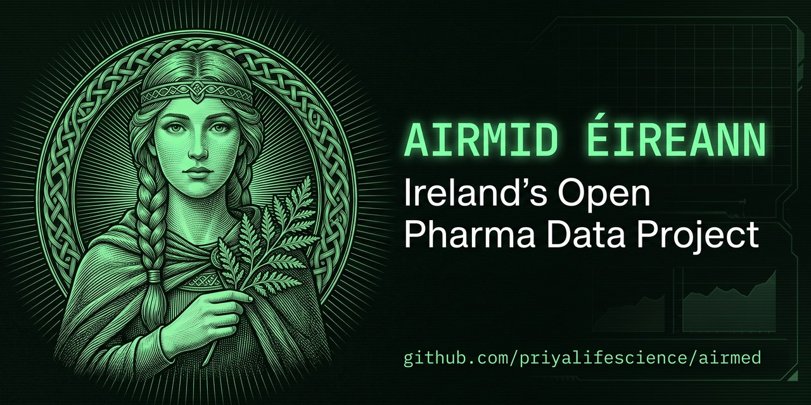

# Airmid Éireann

**Ireland's Open Pharma Data Project**, by [Priya Life Science](https://priyalifescience.com/airmed).

*Ireland's well of open medicine data.* Airmid Éireann collects Ireland's public records on medicines,
clinical trials, approvals and shortages from official sources, checks them, and publishes them as open
datasets, each with its source, licence and date.

> **Status: in development.** First public data release planned for December 2026.

## What it collects today

| Source key | Dataset | Publisher | Licence |
|---|---|---|---|
| `ctgov_ireland` | Clinical trials with a site in Ireland | ClinicalTrials.gov (U.S. NLM) | Public data |
| `ema_shortages` | Medicine shortages in the EU | European Medicines Agency | Re-use with credit |
| `hpra_medicines` | Human medicines authorised in Ireland | HPRA | CC BY 4.0 |

Full details, and the sources we will **not** collect and why: [`sources/registry.json`](sources/registry.json)
and [`LICENSE-DATA.md`](LICENSE-DATA.md).

## Quick start

Python 3.10+ and nothing else (standard library only).

```
python -m airmed list            # every source and its status
python -m airmed run all         # collect all approved sources into ./out
python -m airmed run hpra_medicines --out mydata
```

Each dataset is written as CSV and JSON plus a `datapackage.json` (Frictionless Data) recording the
publisher, licence, retrieval time and file checksums.

## Safety by design

- Public, keyless APIs only. The code needs no passwords or keys and reads none.
- A collector runs only if its source is `approved` in the registry, and requests only the listed fields.
- A privacy guard refuses personal-data fields and blanks any email address or phone number.
- Secret scanning (our own scanner plus Gitleaks over the full history) runs on every push.

See [`SECURITY.md`](SECURITY.md) and [`CHARTER.md`](CHARTER.md).

## Licences

Code: [EUPL-1.2](LICENSE). Data: each source's own licence ([`LICENSE-DATA.md`](LICENSE-DATA.md)).
Nothing here is medical advice.

## The name

Airmid is a healer in early Irish mythology who gathered the healing herbs and sorted them by their powers.
*Éireann* means "of Ireland"; the data catalogue is *Tobar Airmid*, "Airmid's Well".
