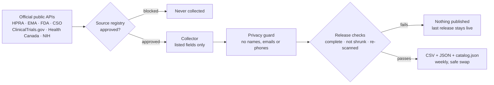

<p align="center">
  
</p>

<h1 align="center">Airmid Éireann</h1>

<p align="center">
  <b>Ireland's well of open medicine data.</b><br>
  Public records on medicines, clinical trials, approvals, shortages and the pharma industry:<br>
  gathered from official sources, checked, and free for anyone to use.
</p>

<p align="center">
  <a href="https://priyalifescience.com/opendata/airmid/v1/"></a>
  <a href="https://priyalifescience.com/opendata/airmid/v1/catalog.json"></a>
  <a href="https://priyalifescience.com/opendata/airmid/v1/CHANGELOG.md"></a>
  <a href="LICENSE"></a>
  <a href="LICENSE-DATA.md"></a>
  
  
  <a href="../../actions/workflows/ci.yml"></a>
</p>

<p align="center">
  <a href="https://priyalifescience.com/opendata/airmid/v1/"><b>Browse the data</b></a> ·
  <a href="https://priyalifescience.com/opendata/airmid/v1/catalog.json"><b>catalog.json</b></a> ·
  <a href="https://priyalifescience.com/opendata/airmid/v1/DATA_DICTIONARY.md"><b>Data dictionary</b></a> ·
  <a href="https://priyalifescience.com/airmed"><b>Project page</b></a> ·
  <a href="CHARTER.md"><b>Charter</b></a>
</p>

---

## The Well

> A project by [Priya Life Science](https://priyalifescience.com/airmed). First release **13 October 2026**: **10 datasets, 32,975 records**.
> Live counts are always in [`catalog.json`](https://priyalifescience.com/opendata/airmid/v1/catalog.json).

| | Dataset | Records\* | Source | Licence | Files |
|:---:|---|---:|---|---|---|
| 🧪 | Clinical trials with an Irish site | 2,698 | ClinicalTrials.gov (U.S. NLM) | Public data | [CSV](https://priyalifescience.com/opendata/airmid/v1/ctgov_ireland/ctgov_ireland.csv) · [JSON](https://priyalifescience.com/opendata/airmid/v1/ctgov_ireland/ctgov_ireland.json) |
| 💊 | Medicines authorised in Ireland | 10,297 | HPRA | CC BY 4.0 | [CSV](https://priyalifescience.com/opendata/airmid/v1/hpra_medicines/hpra_medicines.csv) · [JSON](https://priyalifescience.com/opendata/airmid/v1/hpra_medicines/hpra_medicines.json) |
| 📉 | EU medicine shortages | 85 | European Medicines Agency | Re-use with credit | [CSV](https://priyalifescience.com/opendata/airmid/v1/ema_shortages/ema_shortages.csv) · [JSON](https://priyalifescience.com/opendata/airmid/v1/ema_shortages/ema_shortages.json) |
| 🇪🇺 | EU centrally authorised medicines | 2,351 | European Medicines Agency | Re-use with credit | [CSV](https://priyalifescience.com/opendata/airmid/v1/ema_medicines/ema_medicines.csv) · [JSON](https://priyalifescience.com/opendata/airmid/v1/ema_medicines/ema_medicines.json) |
| 🧬 | EU orphan designations | 3,310 | European Medicines Agency | Re-use with credit | [CSV](https://priyalifescience.com/opendata/airmid/v1/ema_orphans/ema_orphans.csv) · [JSON](https://priyalifescience.com/opendata/airmid/v1/ema_orphans/ema_orphans.json) |
| 📦 | US drug shortages | 1,580 | U.S. FDA (openFDA) | Public domain | [CSV](https://priyalifescience.com/opendata/airmid/v1/fda_shortages/fda_shortages.csv) · [JSON](https://priyalifescience.com/opendata/airmid/v1/fda_shortages/fda_shortages.json) |
| ✅ | US original approvals since 2021 | 4,765 | U.S. FDA (Drugs@FDA) | Public domain | [CSV](https://priyalifescience.com/opendata/airmid/v1/fda_approvals/fda_approvals.csv) · [JSON](https://priyalifescience.com/opendata/airmid/v1/fda_approvals/fda_approvals.json) |
| 🍁 | Health Canada new drug approvals since 2016 | 1,057 | Health Canada | OGL – Canada | [CSV](https://priyalifescience.com/opendata/airmid/v1/hc_approvals/hc_approvals.csv) · [JSON](https://priyalifescience.com/opendata/airmid/v1/hc_approvals/hc_approvals.json) |
| 🚢 | Irish pharma exports by country, monthly | 6,811 | Central Statistics Office | CC BY 4.0 | [CSV](https://priyalifescience.com/opendata/airmid/v1/cso_pharma_exports/cso_pharma_exports.csv) · [JSON](https://priyalifescience.com/opendata/airmid/v1/cso_pharma_exports/cso_pharma_exports.json) |
| 🔬 | NIH awards to Irish organisations | 21 | U.S. NIH | Public domain | [CSV](https://priyalifescience.com/opendata/airmid/v1/nih_ireland/nih_ireland.csv) · [JSON](https://priyalifescience.com/opendata/airmid/v1/nih_ireland/nih_ireland.json) |

<sub>\* First release, 13 Oct 2026. The data refreshes weekly; current counts are in the catalog.</sub>

**Coming later:** patent and exclusivity dates · pharma manufacturing sites in Ireland · company identifiers · medicine spending (UK, US) · EU research funding (CORDIS).

## Get the data

No key, no sign-up. Every file is listed in the catalog.

```bash
# The index of every dataset: licence, record count, fields, file links and checksums
curl https://priyalifescience.com/opendata/airmid/v1/catalog.json

# One dataset as CSV
curl -O https://priyalifescience.com/opendata/airmid/v1/hpra_medicines/hpra_medicines.csv
```

```python
import pandas as pd

exports = pd.read_csv("https://priyalifescience.com/opendata/airmid/v1/cso_pharma_exports/cso_pharma_exports.csv")
print(exports.groupby("country")["exports_eur_thousand"].sum().nlargest(5))
```

<details>
<summary><b>What is in a release</b></summary>

```
opendata/airmid/v1/
├── catalog.json            every dataset: licence, records, fields, file links, SHA-256
├── DATA_DICTIONARY.md      every field of every dataset, described
├── CHANGELOG.md            record counts compared with the previous release
├── index.html              a plain page listing the release
└── <dataset>/
    ├── <dataset>.csv
    ├── <dataset>.json      records plus source, licence and retrieval time
    └── datapackage.json    Frictionless Data descriptor with checksums
```
</details>

## How it works



- **Public, keyless APIs only.** The code needs no passwords or keys and reads none.
- **A registry of sources** ([`sources/registry.json`](sources/registry.json)): a collector runs only if its source is `approved`, with its licence, attribution and the exact fields kept. Sources we may not share are listed as `blocked`, with the reason.
- **A privacy guard** refuses personal-data fields and blanks any email address or phone number, while keeping product codes and identifiers intact.
- **Release checks** refuse a release if a source is missing, a dataset shrank by more than 20%, or a contact-like value appears.
- **Secret scanning** (our own scanner plus Gitleaks over the full history) runs on every push.

## Run it yourself

Python 3.10+ and nothing else (standard library only).

```bash
python -m airmed list                               # every source and its status
python -m airmed run all --out out                  # collect all approved sources
python -m airmed release --src out --dist dist/v1   # build a release with catalog.json
```

## Never shared

| | What | Why |
|:---:|---|---|
| 🔒 | Personal names and contact details | Never included, even when a source publishes them |
| 🏠 | NICE, BfArM and jRCT data | Licensed to Priya Life Science for its own pages only |
| ❓ | EudraGMDP certificates, third-party headcounts, market prices | Terms unclear or restrictive |
| 📄 | Patient leaflets, SmPCs, guidance text | They belong to their publishers; we link to them instead |

## The name

<table>
<tr>
<td width="33%"><br><sub><b>#1 Grow.</b> 365 healing herbs grew from Miach's grave.</sub></td>
<td width="33%"><br><sub><b>#2 Sort.</b> Airmid gathered them on her cloak and sorted each by its power.</sub></td>
<td width="33%"><br><sub><b>#3 Heal.</b> She kept the Well of Sláine, a healing well.</sub></td>
</tr>
</table>

**Airmid** (also written Airmed) is a healer of the Tuatha Dé Danann in early Irish mythology, from the saga
*Cath Maige Tuired*. She gathered the healing herbs and put them in order: that is what this project does with
Ireland's medicine data. *Éireann* means "of Ireland"; the data catalogue is *Tobar Airmid*, "Airmid's Well".

## Licences and credit

- **Code:** [EUPL-1.2](LICENSE)
- **Data:** each dataset keeps the licence of its source, listed in [`LICENSE-DATA.md`](LICENSE-DATA.md) and in every `datapackage.json`.
- **Credit:** please credit the original source and "Airmid Éireann, Priya Life Science". GitHub's **Cite this repository** button gives a ready citation.
- Nothing here is medical advice.

## Contribute

Found an error or know a source we should add? Open an issue using the [forms](../../issues/new/choose), or email
**info@priyalifescience.com**. See [`CONTRIBUTING.md`](CONTRIBUTING.md) and [`SECURITY.md`](SECURITY.md).

<p align="center"><sub>Made in Ireland by <a href="https://priyalifescience.com">Priya Life Science</a> · <i>Ireland's well of open medicine data</i></sub></p>
