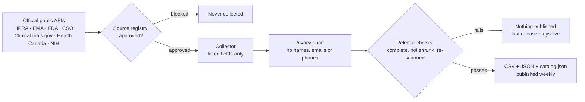

<p align="center">
  <a href="https://priyalifescience.com/airmed"></a>
</p>

<h1 align="center">Airmid Éireann</h1>

<p align="center">
  <b>Ireland's well of open medicine data.</b><br>
  Official public records on medicines, clinical trials, approvals, shortages and the pharma industry,<br>
  gathered, checked and free for anyone to use. By <a href="https://priyalifescience.com"><b>Priya Life Science</b></a>.
</p>

<p align="center">
  <a href="https://priyalifescience.com/opendata/airmid/v1/"></a>
  <a href="https://priyalifescience.com/opendata/airmid/v1/catalog.json"></a>
  <a href="https://priyalifescience.com/opendata/airmid/v1/CHANGELOG.md"></a>
  <a href="https://priyalifescience.com/airmed"></a>
</p>
<p align="center">
  <a href="LICENSE"></a>
  <a href="LICENSE-DATA.md"></a>
  
  
  <a href="../../actions/workflows/ci.yml"></a>
  <a href="../../commits/main"></a>
  <a href="../../stargazers"></a>
  
</p>

<p align="center">
  <a href="#-the-well">The Well</a> ·
  <a href="#-get-the-data">Get the data</a> ·
  <a href="#-how-it-works">How it works</a> ·
  <a href="#-never-shared">Never shared</a> ·
  <a href="#-the-name">The name</a> ·
  <a href="#-more-from-priya-life-science">More from Priya Life Science</a>
</p>

<table align="center">
<tr>
<td align="center" width="25%"><h2>32,975</h2><sub>records in the first release</sub></td>
<td align="center" width="25%"><h2>10</h2><sub>open datasets</sub></td>
<td align="center" width="25%"><h2>7</h2><sub>official publishers</sub></td>
<td align="center" width="25%"><h2>0</h2><sub>personal details, ever</sub></td>
</tr>
</table>

<table>
<tr>
<td width="34%"><a href="https://priyalifescience.com/airmed"></a></td>
<td>

### What is this?

Ireland makes medicines for the world, but the public facts about that industry are scattered across dozens of
registers, spreadsheets and reports. **Airmid Éireann** gathers them from the official publishers, checks them,
and releases them as free, open datasets: **CSV and JSON, with the source, licence and date on every file**.

It is the open-data project of [**Priya Life Science**](https://priyalifescience.com), an Irish life-science
publisher. You can explore the same data as interactive registers on
[priyalifescience.com](https://priyalifescience.com/trackers), or download it here.

**→ [Read the project page](https://priyalifescience.com/airmed)** &nbsp; **→ [Browse the files](https://priyalifescience.com/opendata/airmid/v1/)**

</td>
</tr>
</table>

---

## 🌿 The Well

> First release **13 October 2026**. The data refreshes **weekly**; live counts are always in
> [`catalog.json`](https://priyalifescience.com/opendata/airmid/v1/catalog.json).

| | Dataset | Records\* | Source · licence | Download | Explore on the website |
|:---:|---|---:|---|:---:|---|
| 🧪 | **Clinical trials with an Irish site** | 2,698 | ClinicalTrials.gov · public data | [CSV](https://priyalifescience.com/opendata/airmid/v1/ctgov_ireland/ctgov_ireland.csv) · [JSON](https://priyalifescience.com/opendata/airmid/v1/ctgov_ireland/ctgov_ireland.json) | [Clinical trials in Ireland](https://priyalifescience.com/clinical-trials-ireland) |
| 💊 | **Medicines authorised in Ireland** | 10,297 | HPRA · CC BY 4.0 | [CSV](https://priyalifescience.com/opendata/airmid/v1/hpra_medicines/hpra_medicines.csv) · [JSON](https://priyalifescience.com/opendata/airmid/v1/hpra_medicines/hpra_medicines.json) | [Medicines register](https://priyalifescience.com/medicines) |
| 📉 | **EU medicine shortages** | 85 | EMA · re-use with credit | [CSV](https://priyalifescience.com/opendata/airmid/v1/ema_shortages/ema_shortages.csv) · [JSON](https://priyalifescience.com/opendata/airmid/v1/ema_shortages/ema_shortages.json) | [EU medicine shortages](https://priyalifescience.com/eu-medicine-shortages) |
| 🇪🇺 | **EU centrally authorised medicines** | 2,351 | EMA · re-use with credit | [CSV](https://priyalifescience.com/opendata/airmid/v1/ema_medicines/ema_medicines.csv) · [JSON](https://priyalifescience.com/opendata/airmid/v1/ema_medicines/ema_medicines.json) | [EMA approvals](https://priyalifescience.com/ema-approvals) |
| 🧬 | **EU orphan designations** | 3,310 | EMA · re-use with credit | [CSV](https://priyalifescience.com/opendata/airmid/v1/ema_orphans/ema_orphans.csv) · [JSON](https://priyalifescience.com/opendata/airmid/v1/ema_orphans/ema_orphans.json) | [EU orphan designations](https://priyalifescience.com/ema-orphan-designations) |
| 📦 | **US drug shortages** | 1,580 | U.S. FDA · public domain | [CSV](https://priyalifescience.com/opendata/airmid/v1/fda_shortages/fda_shortages.csv) · [JSON](https://priyalifescience.com/opendata/airmid/v1/fda_shortages/fda_shortages.json) | [Drug shortages](https://priyalifescience.com/drug-shortages) |
| ✅ | **US original approvals since 2021** | 4,765 | U.S. FDA · public domain | [CSV](https://priyalifescience.com/opendata/airmid/v1/fda_approvals/fda_approvals.csv) · [JSON](https://priyalifescience.com/opendata/airmid/v1/fda_approvals/fda_approvals.json) | [FDA approvals](https://priyalifescience.com/fda-approvals) |
| 🍁 | **Health Canada approvals since 2016** | 1,057 | Health Canada · OGL Canada | [CSV](https://priyalifescience.com/opendata/airmid/v1/hc_approvals/hc_approvals.csv) · [JSON](https://priyalifescience.com/opendata/airmid/v1/hc_approvals/hc_approvals.json) | [Health Canada approvals](https://priyalifescience.com/health-canada-approvals) |
| 🚢 | **Irish pharma exports by country** | 6,811 | CSO · CC BY 4.0 | [CSV](https://priyalifescience.com/opendata/airmid/v1/cso_pharma_exports/cso_pharma_exports.csv) · [JSON](https://priyalifescience.com/opendata/airmid/v1/cso_pharma_exports/cso_pharma_exports.json) | [Ireland pharma exports](https://priyalifescience.com/ireland-pharma-exports) |
| 🔬 | **NIH awards to Irish organisations** | 21 | U.S. NIH · public domain | [CSV](https://priyalifescience.com/opendata/airmid/v1/nih_ireland/nih_ireland.csv) · [JSON](https://priyalifescience.com/opendata/airmid/v1/nih_ireland/nih_ireland.json) | [Ireland research funding](https://priyalifescience.com/ireland-research-funding) |

<sub>\* First release, 13 Oct 2026.</sub>

**Coming later:** patent and exclusivity dates · pharma manufacturing sites in Ireland · company identifiers ·
medicine spending (UK, US) · EU research funding (CORDIS).

## ⚡ Get the data

No key, no sign-up. Every file is listed in the catalog, with its checksum.

```bash
# The index of every dataset: licence, record count, fields, file links and checksums
curl https://priyalifescience.com/opendata/airmid/v1/catalog.json

# One dataset as CSV
curl -O https://priyalifescience.com/opendata/airmid/v1/hpra_medicines/hpra_medicines.csv
```

```python
import pandas as pd

exports = pd.read_csv("https://priyalifescience.com/opendata/airmid/v1/cso_pharma_exports/cso_pharma_exports.csv")
print(exports.groupby("country")["exports_eur_thousand"].sum().nlargest(5))
```

<details>
<summary><b>What is in a release</b></summary>

```
opendata/airmid/v1/
├── catalog.json            every dataset: licence, records, fields, file links, SHA-256
├── DATA_DICTIONARY.md      every field of every dataset, described
├── CHANGELOG.md            record counts compared with the previous release
├── citation.bib / .ris     for Zotero, Mendeley, EndNote and LaTeX
├── index.html              a plain page listing the release
└── <dataset>/
    ├── <dataset>.csv
    ├── <dataset>.json      records plus source, licence and retrieval time
    └── datapackage.json    Frictionless Data descriptor with checksums
```
</details>

## 🔍 How it works



| Safeguard | What it does |
|---|---|
| **Keyless public APIs** | The code needs no passwords or keys and reads none |
| **Source registry** ([`sources/registry.json`](sources/registry.json)) | A collector runs only if its source is `approved`, with its licence, attribution and exact fields recorded |
| **Privacy guard** | Refuses personal-data fields; blanks emails and phone numbers; keeps product codes intact |
| **Release checks** | Refuses a release if a source is missing, a dataset shrank by more than 20%, or a contact-like value appears |
| **Secret scanning** | Our scanner plus Gitleaks over the full history on every change; GitHub push protection |
| **Encrypted publishing** | Releases are uploaded over FTPS with a verified certificate, and swapped in only once complete |

## 🛠️ Run it yourself

Python 3.10+ and nothing else (standard library only).

```bash
git clone https://github.com/priyalifescience/airmed && cd airmed
python -m airmed list                               # every source and its status
python -m airmed run all --out out                  # collect all approved sources
python -m airmed release --src out --dist dist/v1   # build a release with catalog.json
```

## 🔒 Never shared

| | What | Why |
|:---:|---|---|
| 🙅 | Personal names and contact details | Never included, even when a source publishes them |
| 🏠 | NICE, BfArM and jRCT data | Licensed to Priya Life Science for its own pages only |
| ❓ | EudraGMDP certificates, third-party headcounts, market prices | Terms unclear or restrictive |
| 📄 | Patient leaflets, SmPCs, guidance text | They belong to their publishers; we link to them instead |

## 🌱 The name

<table>
<tr>
<td width="33%"><br><sub><b>#1 Grow.</b> 365 healing herbs grew from Miach's grave.</sub></td>
<td width="33%"><br><sub><b>#2 Sort.</b> Airmid gathered them on her cloak and sorted each by its power.</sub></td>
<td width="33%"><br><sub><b>#3 Heal.</b> She kept the Well of Sláine, a healing well.</sub></td>
</tr>
</table>

**Airmid** (also written Airmed) is a healer of the Tuatha Dé Danann in early Irish mythology, from the saga
*Cath Maige Tuired*. She gathered the healing herbs and put them in order: that is what this project does with
Ireland's medicine data. *Éireann* means "of Ireland"; the data catalogue is *Tobar Airmid*, "Airmid's Well".
The full story is on the [project page](https://priyalifescience.com/airmed#story).

## 🌍 More from Priya Life Science

Airmid Éireann is built by [**Priya Life Science**](https://priyalifescience.com), which publishes news, data
registers and guides on the pharma, biotech and medtech industry in Ireland.

| Explore | | |
|---|---|---|
| 🗺️ [Ireland pharma map](https://priyalifescience.com/ireland-pharma-map) | 🔎 [Clinical trial finder](https://priyalifescience.com/clinical-trials-finder) | 📊 [Irish clinical trials dashboard](https://priyalifescience.com/ireland-clinical-trials-dashboard) |
| 🌐 [Drug approvals worldwide](https://priyalifescience.com/drug-approvals-worldwide) | 🗂️ [All data registers](https://priyalifescience.com/trackers) | 📘 [Guides](https://priyalifescience.com/guides) |
| ♻️ [Reuse our data](https://priyalifescience.com/reuse-our-data) | 🧭 [How we build our data](https://priyalifescience.com/methodology) | ✏️ [Corrections log](https://priyalifescience.com/corrections) |

## 📜 Licences and credit

- **Code:** [EUPL-1.2](LICENSE)
- **Data:** each dataset keeps the licence of its source, listed in [`LICENSE-DATA.md`](LICENSE-DATA.md) and in every `datapackage.json`.
- **Credit:** please credit the original source and "Airmid Éireann, [Priya Life Science](https://priyalifescience.com/airmed)". GitHub's **Cite this repository** button and the [BibTeX](https://priyalifescience.com/opendata/airmid/v1/citation.bib) / [RIS](https://priyalifescience.com/opendata/airmid/v1/citation.ris) files give a ready citation.
- Nothing here is medical advice.

## 🤝 Contribute

Found an error or know a source we should add? Use the [issue forms](../../issues/new/choose), start a
[discussion](../../discussions), or email **info@priyalifescience.com**. See [`CONTRIBUTING.md`](CONTRIBUTING.md),
[`CODE_OF_CONDUCT.md`](CODE_OF_CONDUCT.md) and [`SECURITY.md`](SECURITY.md).

---

<p align="center">
  <a href="https://priyalifescience.com"><b>priyalifescience.com</b></a> ·
  <a href="https://priyalifescience.com/airmed">Project page</a> ·
  <a href="https://priyalifescience.com/opendata/airmid/v1/">Open data</a><br>
  <sub>Made in Ireland by Priya Life Science · <i>Ireland's well of open medicine data</i></sub>
</p>
