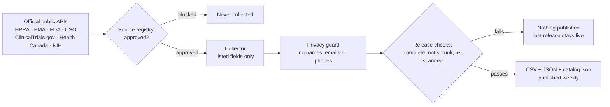

<p align="center">
  <a href="https://priyalifescience.com/airmed"></a>
</p>

<h1 align="center">Airmid Éireann</h1>

<p align="center">
  <b>Ireland's well of open medicine data.</b><br>
  Official public records on medicines, clinical trials, approvals, shortages and the pharma industry,<br>
  gathered, checked and free for anyone to use. By <a href="https://priyalifescience.com"><b>Priya Life Science</b></a>.
</p>

<p align="center">
  <a href="https://priyalifescience.com/opendata/airmid/v1/"></a>
  <a href="https://priyalifescience.com/opendata/airmid/v1/catalog.json"></a>
  <a href="https://priyalifescience.com/opendata/airmid/v1/CHANGELOG.md"></a>
  <a href="https://priyalifescience.com/airmed"></a>
  <a href="https://doi.org/10.5281/zenodo.23336432"></a>
  <a href="https://www.kaggle.com/datasets/sreepriyaprasannan/airmid-eireann-irelands-open-pharma-data"></a>
</p>
<p align="center">
  <a href="LICENSE"></a>
  <a href="LICENSE-DATA.md"></a>
  
  
  <a href="../../actions/workflows/ci.yml"></a>
  <a href="../../commits/main"></a>
  <a href="../../stargazers"></a>
  
</p>

<p align="center">
  <a href="#-the-well">The Well</a> ·
  <a href="#-get-the-data">Get the data</a> ·
  <a href="#-how-it-works">How it works</a> ·
  <a href="#-never-shared">Never shared</a> ·
  <a href="#-the-name">The name</a> ·
  <a href="#-more-from-priya-life-science">More from Priya Life Science</a>
</p>

<table align="center">
<tr>
<td align="center" width="25%"><h2>1,770,490</h2><sub>records, release of 2026-10-27</sub></td>
<td align="center" width="25%"><h2>71</h2><sub>open datasets</sub></td>
<td align="center" width="25%"><h2>38</h2><sub>official publishers</sub></td>
<td align="center" width="25%"><h2>0</h2><sub>personal details, ever</sub></td>
</tr>
</table>

<table>
<tr>
<td width="34%"><a href="https://priyalifescience.com/airmed"></a></td>
<td>

### What is this?

Ireland makes medicines for the world, but the public facts about that industry are scattered across dozens of
registers, spreadsheets and reports. **Airmid Éireann** gathers them from the official publishers, checks them,
and releases them as free, open datasets: **CSV and JSON, with the source, licence and date on every file**.

It is the open-data project of [**Priya Life Science**](https://priyalifescience.com), an Irish life-science
publisher. You can explore the same data as interactive registers on
[priyalifescience.com](https://priyalifescience.com/trackers), or download it here.

**→ [Read the project page](https://priyalifescience.com/airmed)** &nbsp; **→ [Search the data](https://priyalifescience.com/opendata/airmid/v1/search/)** &nbsp; **→ [Browse the files](https://priyalifescience.com/opendata/airmid/v1/)**

</td>
</tr>
</table>

---

## 🌿 The Well

> First release **13 October 2026**; Europe, research and safety data 15 October; patents, companies, Canada, EMA extras, spending and waiting lists 18 October 2026. The data refreshes **weekly**; live counts are always in
> [`catalog.json`](https://priyalifescience.com/opendata/airmid/v1/catalog.json).

| Dataset | Records\* | Source · licence | Download | Explore |
|---|---:|---|:---:|---|
| **ClinicalTrials.gov: studies with a site in Europe, started 2015 or later** | 113,679 | U.S. National Library of Medicine · ClinicalTrials.gov terms | [CSV](https://priyalifescience.com/opendata/airmid/v1/ctgov_europe/ctgov_europe.csv) · [JSON](https://priyalifescience.com/opendata/airmid/v1/ctgov_europe/ctgov_europe.json) |  |
| **ClinicalTrials.gov: studies with a site in Ireland** | 2,702 | U.S. National Library of Medicine · ClinicalTrials.gov terms | [CSV](https://priyalifescience.com/opendata/airmid/v1/ctgov_ireland/ctgov_ireland.csv) · [JSON](https://priyalifescience.com/opendata/airmid/v1/ctgov_ireland/ctgov_ireland.json) | [website](https://priyalifescience.com/clinical-trials-ireland) |
| **CORDIS: EU-funded health, medicine, pharma and biotech research projects (Horizon 2020 and Horizon Europe)** | 14,111 | European Commission · CC BY 4.0 | [CSV](https://priyalifescience.com/opendata/airmid/v1/cordis_health/cordis_health.csv) · [JSON](https://priyalifescience.com/opendata/airmid/v1/cordis_health/cordis_health.json) | [website](https://priyalifescience.com/ireland-research-funding) |
| **CSO: Irish exports of medicinal and pharmaceutical products by country (TSM10)** | 6,860 | Central Statistics Office · CC BY 4.0 | [CSV](https://priyalifescience.com/opendata/airmid/v1/cso_pharma_exports/cso_pharma_exports.csv) · [JSON](https://priyalifescience.com/opendata/airmid/v1/cso_pharma_exports/cso_pharma_exports.json) | [website](https://priyalifescience.com/ireland-pharma-exports) |
| **CSO: Irish pharmaceutical industry statistics (NACE 21): production indices, earnings, Census of Industrial Production, Pharmaceutical and Medical Manufacturing series** | 1,905 | Central Statistics Office · CC BY 4.0 | [CSV](https://priyalifescience.com/opendata/airmid/v1/cso_pharma_industry_stats/cso_pharma_industry_stats.csv) · [JSON](https://priyalifescience.com/opendata/airmid/v1/cso_pharma_industry_stats/cso_pharma_industry_stats.json) |  |
| **CSO: System of Health Accounts for Ireland: current health care expenditure by function, provider and financing scheme** | 13,706 | Central Statistics Office · CC BY 4.0 | [CSV](https://priyalifescience.com/opendata/airmid/v1/cso_health_accounts/cso_health_accounts.csv) · [JSON](https://priyalifescience.com/opendata/airmid/v1/cso_health_accounts/cso_health_accounts.json) |  |
| **Department of Health / HSE: hospital discharge summary statistics (HIPE): discharges, bed days, length of stay and standardised rates by diagnosis, procedure, age, sex and county** | 111,352 | Department of Health · CC BY 4.0 | [CSV](https://priyalifescience.com/opendata/airmid/v1/cso_hospital_discharges/cso_hospital_discharges.csv) · [JSON](https://priyalifescience.com/opendata/airmid/v1/cso_hospital_discharges/cso_hospital_discharges.json) |  |
| **Department of Health: Health in Ireland Key Trends tables on medicines, prescribing, health spending, eligibility schemes and the hospital workforce** | 1,350 | Department of Health · CC BY 4.0 | [CSV](https://priyalifescience.com/opendata/airmid/v1/doh_health_key_trends/doh_health_key_trends.csv) · [JSON](https://priyalifescience.com/opendata/airmid/v1/doh_health_key_trends/doh_health_key_trends.json) |  |
| **ECDC ESAC-Net: antimicrobial consumption by EU/EEA country, sector, ATC group and year (Annual Epidemiological Report 2022, downloadable tables D1-D24)** | 6,192 | European Centre for Disease Prevention and Control · CC BY 4.0 | [CSV](https://priyalifescience.com/opendata/airmid/v1/ecdc_antimicrobial_consumption/ecdc_antimicrobial_consumption.csv) · [JSON](https://priyalifescience.com/opendata/airmid/v1/ecdc_antimicrobial_consumption/ecdc_antimicrobial_consumption.json) |  |
| **EEA Industrial Reporting (E-PRTR): pollutant releases and waste transfers of Irish chemical and pharmaceutical facilities** | 19,871 | European Environment Agency · CC BY 4.0 | [CSV](https://priyalifescience.com/opendata/airmid/v1/eea_industrial_emissions_ireland/eea_industrial_emissions_ireland.csv) · [JSON](https://priyalifescience.com/opendata/airmid/v1/eea_industrial_emissions_ireland/eea_industrial_emissions_ireland.json) | [website](https://priyalifescience.com/ireland-pharma-map) |
| **EMA: decisions on paediatric investigation plans (PIPs) and waivers** | 3,394 | European Medicines Agency · EMA legal notice | [CSV](https://priyalifescience.com/opendata/airmid/v1/ema_paediatric_plans/ema_paediatric_plans.csv) · [JSON](https://priyalifescience.com/opendata/airmid/v1/ema_paediatric_plans/ema_paediatric_plans.json) |  |
| **EMA: EU orphan designations** | 3,310 | European Medicines Agency · EMA legal notice | [CSV](https://priyalifescience.com/opendata/airmid/v1/ema_orphans/ema_orphans.csv) · [JSON](https://priyalifescience.com/opendata/airmid/v1/ema_orphans/ema_orphans.json) | [website](https://priyalifescience.com/ema-orphan-designations) |
| **EMA: human medicines evaluated by the European Medicines Agency** | 2,357 | European Medicines Agency · EMA legal notice | [CSV](https://priyalifescience.com/opendata/airmid/v1/ema_medicines/ema_medicines.csv) · [JSON](https://priyalifescience.com/opendata/airmid/v1/ema_medicines/ema_medicines.json) | [website](https://priyalifescience.com/ema-approvals) |
| **EMA: medicine shortages (human)** | 85 | European Medicines Agency · EMA legal notice | [CSV](https://priyalifescience.com/opendata/airmid/v1/ema_shortages/ema_shortages.csv) · [JSON](https://priyalifescience.com/opendata/airmid/v1/ema_shortages/ema_shortages.json) | [website](https://priyalifescience.com/eu-medicine-shortages) |
| **EMA: medicines granted PRIME eligibility (current and previous)** | 177 | European Medicines Agency · EMA legal notice | [CSV](https://priyalifescience.com/opendata/airmid/v1/ema_prime/ema_prime.csv) · [JSON](https://priyalifescience.com/opendata/airmid/v1/ema_prime/ema_prime.json) |  |
| **EMA: periodic safety update single assessment (PSUSA) outcomes** | 2,738 | European Medicines Agency · EMA legal notice | [CSV](https://priyalifescience.com/opendata/airmid/v1/ema_psusa/ema_psusa.csv) · [JSON](https://priyalifescience.com/opendata/airmid/v1/ema_psusa/ema_psusa.json) |  |
| **EMA: referral procedures for human medicines** | 461 | European Medicines Agency · EMA legal notice | [CSV](https://priyalifescience.com/opendata/airmid/v1/ema_referrals/ema_referrals.csv) · [JSON](https://priyalifescience.com/opendata/airmid/v1/ema_referrals/ema_referrals.json) |  |
| **EPA Ireland: industrial emissions (IE), IPPC and IPC licences for pharmaceutical manufacturing** | 52 | Environmental Protection Agency · CC BY 4.0 | [CSV](https://priyalifescience.com/opendata/airmid/v1/epa_pharma_licences/epa_pharma_licences.csv) · [JSON](https://priyalifescience.com/opendata/airmid/v1/epa_pharma_licences/epa_pharma_licences.json) | [website](https://priyalifescience.com/ireland-pharma-map) |
| **eTenders (Ireland): public procurement notices and contract awards in health, medicines and medical technology, 2013 onwards** | 6,914 | Office of Government Procurement · CC BY 4.0 | [CSV](https://priyalifescience.com/opendata/airmid/v1/etenders_health_awards/etenders_health_awards.csv) · [JSON](https://priyalifescience.com/opendata/airmid/v1/etenders_health_awards/etenders_health_awards.json) |  |
| **EU orphan market exclusivity (Union Register of medicinal products)** | 369 | European Commission · CC BY 4.0 | [CSV](https://priyalifescience.com/opendata/airmid/v1/eu_orphan_exclusivity/eu_orphan_exclusivity.csv) · [JSON](https://priyalifescience.com/opendata/airmid/v1/eu_orphan_exclusivity/eu_orphan_exclusivity.json) | [website](https://priyalifescience.com/drug-patent-expiry) |
| **European Commission merger cases in the pharmaceutical sector (NACE C.21, G.46.46, G.47.73), with decisions** | 285 | European Commission · CC BY 4.0 | [CSV](https://priyalifescience.com/opendata/airmid/v1/ec_merger_cases_pharma/ec_merger_cases_pharma.csv) · [JSON](https://priyalifescience.com/opendata/airmid/v1/ec_merger_cases_pharma/ec_merger_cases_pharma.json) |  |
| **Eurostat: EU member states' trade in medicinal and pharmaceutical products (SITC 54), by partner** | 207,276 | Eurostat · reuse with credit | [CSV](https://priyalifescience.com/opendata/airmid/v1/eurostat_pharma_trade/eurostat_pharma_trade.csv) · [JSON](https://priyalifescience.com/opendata/airmid/v1/eurostat_pharma_trade/eurostat_pharma_trade.json) |  |
| **Eurostat: pharmaceutical manufacturing industry (NACE C21) by country: enterprises, employment, turnover, value added, production index** | 32,436 | Eurostat · reuse with credit | [CSV](https://priyalifescience.com/opendata/airmid/v1/eurostat_pharma_industry/eurostat_pharma_industry.csv) · [JSON](https://priyalifescience.com/opendata/airmid/v1/eurostat_pharma_industry/eurostat_pharma_industry.json) |  |
| **Finland: Fimea basic register of human medicinal products (with ATC and substitution groups) and medicine shortage notices** | 28,688 | Fimea · CC BY 4.0 | [CSV](https://priyalifescience.com/opendata/airmid/v1/fi_fimea_medicines/fi_fimea_medicines.csv) · [JSON](https://priyalifescience.com/opendata/airmid/v1/fi_fimea_medicines/fi_fimea_medicines.json) |  |
| **France: active substances and dosages of every medicine on the public medicines database (BDPM)** | 32,439 | Base de données publique des médicaments · see datapackage | [CSV](https://priyalifescience.com/opendata/airmid/v1/fr_bdpm_compositions/fr_bdpm_compositions.csv) · [JSON](https://priyalifescience.com/opendata/airmid/v1/fr_bdpm_compositions/fr_bdpm_compositions.json) |  |
| **France: ANSM medicine availability notices (stock-outs, supply tensions, withdrawals) from the BDPM** | 703 | Base de données publique des médicaments · see datapackage | [CSV](https://priyalifescience.com/opendata/airmid/v1/fr_bdpm_availability/fr_bdpm_availability.csv) · [JSON](https://priyalifescience.com/opendata/airmid/v1/fr_bdpm_availability/fr_bdpm_availability.json) | [website](https://priyalifescience.com/eu-medicine-shortages) |
| **France: HAS Transparency Committee SMR and ASMR ratings of medicines since 2002 (BDPM)** | 25,664 | Base de données publique des médicaments · see datapackage | [CSV](https://priyalifescience.com/opendata/airmid/v1/fr_bdpm_has_opinions/fr_bdpm_has_opinions.csv) · [JSON](https://priyalifescience.com/opendata/airmid/v1/fr_bdpm_has_opinions/fr_bdpm_has_opinions.json) |  |
| **France: medicines and presentations on the public medicines database (BDPM), with prices, reimbursement rates and MITM ATC codes** | 22,158 | Base de données publique des médicaments · see datapackage | [CSV](https://priyalifescience.com/opendata/airmid/v1/fr_bdpm_medicines/fr_bdpm_medicines.csv) · [JSON](https://priyalifescience.com/opendata/airmid/v1/fr_bdpm_medicines/fr_bdpm_medicines.json) |  |
| **France: reimbursed medicines dispensed in community pharmacies, national totals by year and ATC5 or CIP13 (Open Medic)** | 68,898 | Caisse nationale de l'Assurance Maladie · see datapackage | [CSV](https://priyalifescience.com/opendata/airmid/v1/fr_open_medic/fr_open_medic.csv) · [JSON](https://priyalifescience.com/opendata/airmid/v1/fr_open_medic/fr_open_medic.json) | [website](https://priyalifescience.com/drug-spending) |
| **Health Canada Drug Product Database: human drug products (all DINs)** | 51,123 | Health Canada · OGL Canada | [CSV](https://priyalifescience.com/opendata/airmid/v1/hc_drug_product_database/hc_drug_product_database.csv) · [JSON](https://priyalifescience.com/opendata/airmid/v1/hc_drug_product_database/hc_drug_product_database.json) |  |
| **Health Canada Notice of Compliance database: all human-medicine NOCs since 1994 (NDS, SNDS, ANDS, SANDS)** | 23,667 | Health Canada · OGL Canada | [CSV](https://priyalifescience.com/opendata/airmid/v1/hc_notice_of_compliance/hc_notice_of_compliance.csv) · [JSON](https://priyalifescience.com/opendata/airmid/v1/hc_notice_of_compliance/hc_notice_of_compliance.json) |  |
| **Health Canada Recalls and Safety Alerts: health products (drugs, natural health products, biologics, medical devices)** | 13,308 | Health Canada · OGL Canada | [CSV](https://priyalifescience.com/opendata/airmid/v1/hc_recalls/hc_recalls.csv) · [JSON](https://priyalifescience.com/opendata/airmid/v1/hc_recalls/hc_recalls.json) |  |
| **Health Canada: New Drug Submission approvals since 2016** | 1,061 | Health Canada · OGL Canada | [CSV](https://priyalifescience.com/opendata/airmid/v1/hc_approvals/hc_approvals.csv) · [JSON](https://priyalifescience.com/opendata/airmid/v1/hc_approvals/hc_approvals.json) | [website](https://priyalifescience.com/health-canada-approvals) |
| **HPRA: human medicines authorised in Ireland** | 10,290 | Health Products Regulatory Authority · CC BY 4.0 | [CSV](https://priyalifescience.com/opendata/airmid/v1/hpra_medicines/hpra_medicines.csv) · [JSON](https://priyalifescience.com/opendata/airmid/v1/hpra_medicines/hpra_medicines.json) | [website](https://priyalifescience.com/medicines) |
| **Ireland (HSE-PCRS): reimbursable items under the State schemes, with reimbursement and reference prices** | 8,088 | Health Service Executive · HSE-PCRS written permission | [CSV](https://priyalifescience.com/opendata/airmid/v1/pcrs_reimbursable_items/pcrs_reimbursable_items.csv) · [JSON](https://priyalifescience.com/opendata/airmid/v1/pcrs_reimbursable_items/pcrs_reimbursable_items.json) |  |
| **Italy (AIFA): authorised manufacturing sites for medicines, medical gases and active substances (Officine autorizzate), by town and region** | 693 | Agenzia Italiana del Farmaco · CC BY 4.0 | [CSV](https://priyalifescience.com/opendata/airmid/v1/it_aifa_manufacturing_sites/it_aifa_manufacturing_sites.csv) · [JSON](https://priyalifescience.com/opendata/airmid/v1/it_aifa_manufacturing_sites/it_aifa_manufacturing_sites.json) |  |
| **Italy (AIFA): clinical trials of medicines in the national observatory OsSC (ongoing, concluded, not approved or withdrawn), with participating centres, 2018 to January 2025** | 3,330 | Agenzia Italiana del Farmaco · CC BY 4.0 | [CSV](https://priyalifescience.com/opendata/airmid/v1/it_aifa_clinical_trials/it_aifa_clinical_trials.csv) · [JSON](https://priyalifescience.com/opendata/airmid/v1/it_aifa_clinical_trials/it_aifa_clinical_trials.json) |  |
| **Italy (AIFA): medicines reimbursed by the national health service, Class A (community) and Class H (hospital) lists, with prices and ATC codes** | 13,210 | Agenzia Italiana del Farmaco · CC BY 4.0 | [CSV](https://priyalifescience.com/opendata/airmid/v1/it_aifa_reimbursed_medicines/it_aifa_reimbursed_medicines.csv) · [JSON](https://priyalifescience.com/opendata/airmid/v1/it_aifa_reimbursed_medicines/it_aifa_reimbursed_medicines.json) |  |
| **Italy (AIFA): medicines temporarily in shortage (Lista dei farmaci temporaneamente carenti)** | 2,512 | Agenzia Italiana del Farmaco · CC BY 4.0 | [CSV](https://priyalifescience.com/opendata/airmid/v1/it_aifa_shortages/it_aifa_shortages.csv) · [JSON](https://priyalifescience.com/opendata/airmid/v1/it_aifa_shortages/it_aifa_shortages.json) |  |
| **Italy (AIFA): national medicines spending and packs by reimbursement class and ATC (4th level), community pharmacies and direct purchases, per year from 2016** | 10,751 | Agenzia Italiana del Farmaco · CC BY 4.0 | [CSV](https://priyalifescience.com/opendata/airmid/v1/it_aifa_medicines_spending/it_aifa_medicines_spending.csv) · [JSON](https://priyalifescience.com/opendata/airmid/v1/it_aifa_medicines_spending/it_aifa_medicines_spending.json) |  |
| **MHRA (UK): drug and device alerts and Drug Safety Update** | 2,326 | Medicines and Healthcare products Regulatory Agency · OGL v3 | [CSV](https://priyalifescience.com/opendata/airmid/v1/mhra_safety_alerts/mhra_safety_alerts.csv) · [JSON](https://priyalifescience.com/opendata/airmid/v1/mhra_safety_alerts/mhra_safety_alerts.json) |  |
| **Netherlands: outpatient medicine use and cost per ATC code and year under the Zvw (GIPdatabank)** | 17,795 | Zorginstituut Nederland · CC0 | [CSV](https://priyalifescience.com/opendata/airmid/v1/nl_gip_medicine_use/nl_gip_medicine_use.csv) · [JSON](https://priyalifescience.com/opendata/airmid/v1/nl_gip_medicine_use/nl_gip_medicine_use.json) | [website](https://priyalifescience.com/drug-spending) |
| **NHS England Prescription Cost Analysis: monthly items and cost by BNF chemical substance** | 118,446 | NHS Business Services Authority · OGL v3 | [CSV](https://priyalifescience.com/opendata/airmid/v1/nhs_prescription_costs/nhs_prescription_costs.csv) · [JSON](https://priyalifescience.com/opendata/airmid/v1/nhs_prescription_costs/nhs_prescription_costs.json) | [website](https://priyalifescience.com/drug-spending) |
| **NIH RePORTER: US NIH awards to organisations in Ireland** | 21 | U.S. National Institutes of Health · ODbL 1.0 (share-alike) | [CSV](https://priyalifescience.com/opendata/airmid/v1/nih_ireland/nih_ireland.csv) · [JSON](https://priyalifescience.com/opendata/airmid/v1/nih_ireland/nih_ireland.json) | [website](https://priyalifescience.com/ireland-research-funding) |
| **Northern Ireland GP prescribing: monthly items and cost by BNF chemical substance and formulation** | 86,689 | Business Services Organisation · OGL v3 | [CSV](https://priyalifescience.com/opendata/airmid/v1/ni_bso_gp_prescribing/ni_bso_gp_prescribing.csv) · [JSON](https://priyalifescience.com/opendata/airmid/v1/ni_bso_gp_prescribing/ni_bso_gp_prescribing.json) | [website](https://priyalifescience.com/drug-spending) |
| **Norway: FEST medicine packages with ATC, pharmacy prices, reimbursement and substitution groups** | 10,817 | Direktoratet for medisinske produkter · see datapackage | [CSV](https://priyalifescience.com/opendata/airmid/v1/no_fest_medicines/no_fest_medicines.csv) · [JSON](https://priyalifescience.com/opendata/airmid/v1/no_fest_medicines/no_fest_medicines.json) |  |
| **NTPF: Irish public hospital waiting lists (outpatient, inpatient/day case, GI endoscopy), latest 24 monthly snapshots** | 9,924 | National Treatment Purchase Fund · NTPF re-use terms | [CSV](https://priyalifescience.com/opendata/airmid/v1/ntpf_waiting_lists/ntpf_waiting_lists.csv) · [JSON](https://priyalifescience.com/opendata/airmid/v1/ntpf_waiting_lists/ntpf_waiting_lists.json) |  |
| **OECD Health Statistics: pharmaceutical spending by country (System of Health Accounts)** | 70,802 | OECD · OECD terms | [CSV](https://priyalifescience.com/opendata/airmid/v1/oecd_pharma_spending/oecd_pharma_spending.csv) · [JSON](https://priyalifescience.com/opendata/airmid/v1/oecd_pharma_spending/oecd_pharma_spending.json) |  |
| **Oireachtas: parliamentary questions on medicines, drugs, pharmaceuticals and the HPRA (Health and Enterprise), 2020 onward** | 10,323 | Houses of the Oireachtas · Oireachtas PSI licence | [CSV](https://priyalifescience.com/opendata/airmid/v1/oireachtas_medicine_questions/oireachtas_medicine_questions.csv) · [JSON](https://priyalifescience.com/opendata/airmid/v1/oireachtas_medicine_questions/oireachtas_medicine_questions.json) | [website](https://priyalifescience.com/medicines) |
| **OpenAlex: European-affiliated research (EU-27, UK, Norway, Switzerland) in pharmacology, pharmaceutics, toxicology and drug discovery (2023 onwards)** | 86,168 | OurResearch · CC0 | [CSV](https://priyalifescience.com/opendata/airmid/v1/openalex_europe_pharma/openalex_europe_pharma.csv) · [JSON](https://priyalifescience.com/opendata/airmid/v1/openalex_europe_pharma/openalex_europe_pharma.json) |  |
| **OpenAlex: Irish-affiliated research in pharmacology, pharmaceutics, toxicology and drug discovery (2015 onwards)** | 4,302 | OurResearch · CC0 | [CSV](https://priyalifescience.com/opendata/airmid/v1/openalex_ireland_pharma/openalex_ireland_pharma.csv) · [JSON](https://priyalifescience.com/opendata/airmid/v1/openalex_ireland_pharma/openalex_ireland_pharma.json) |  |
| **Pharma, biotech and medtech companies relevant to Ireland: identifier crosswalk (Wikidata, LEI, CRO number)** | 100 | Wikidata · CC0 / CC BY 4.0 | [CSV](https://priyalifescience.com/opendata/airmid/v1/pharma_company_ids/pharma_company_ids.csv) · [JSON](https://priyalifescience.com/opendata/airmid/v1/pharma_company_ids/pharma_company_ids.json) |  |
| **PHARMAC Pharmaceutical Schedule (New Zealand): funded packs with subsidy, price and restrictions, latest monthly edition** | 2,507 | PHARMAC · see datapackage | [CSV](https://priyalifescience.com/opendata/airmid/v1/nz_pharmac_schedule/nz_pharmac_schedule.csv) · [JSON](https://priyalifescience.com/opendata/airmid/v1/nz_pharmac_schedule/nz_pharmac_schedule.json) |  |
| **Research Ireland (formerly Science Foundation Ireland): research grant commitments, 2000 to the latest published file (Irish Research Council grants not included)** | 8,475 | Taighde Éireann – Research Ireland · CC BY 4.0 | [CSV](https://priyalifescience.com/opendata/airmid/v1/research_ireland_grants/research_ireland_grants.csv) · [JSON](https://priyalifescience.com/opendata/airmid/v1/research_ireland_grants/research_ireland_grants.json) |  |
| **Scotland community prescribing: monthly items and cost by BNF chemical substance** | 65,711 | Public Health Scotland · OGL v3 | [CSV](https://priyalifescience.com/opendata/airmid/v1/scot_phs_prescribing/scot_phs_prescribing.csv) · [JSON](https://priyalifescience.com/opendata/airmid/v1/scot_phs_prescribing/scot_phs_prescribing.json) | [website](https://priyalifescience.com/drug-spending) |
| **SEC EDGAR XBRL: revenue by product, large pharma, biotech and medtech companies (10-K, 10-Q, 20-F)** | 23,591 | U.S. Securities and Exchange Commission · SEC public information | [CSV](https://priyalifescience.com/opendata/airmid/v1/sec_product_revenue/sec_product_revenue.csv) · [JSON](https://priyalifescience.com/opendata/airmid/v1/sec_product_revenue/sec_product_revenue.json) |  |
| **SEC EDGAR: Form 8-K filings with Item 1.01 (material definitive agreement) or Item 2.01 (completed acquisition or disposal), large pharma, biotech and medtech companies** | 396 | U.S. Securities and Exchange Commission · SEC public information | [CSV](https://priyalifescience.com/opendata/airmid/v1/sec_8k_deals/sec_8k_deals.csv) · [JSON](https://priyalifescience.com/opendata/airmid/v1/sec_8k_deals/sec_8k_deals.json) |  |
| **Singapore HSA: Listing of Registered Therapeutic Products, with manufacturer and country of manufacture** | 5,511 | Health Sciences Authority · see datapackage | [CSV](https://priyalifescience.com/opendata/airmid/v1/sg_hsa_registered_products/sg_hsa_registered_products.csv) · [JSON](https://priyalifescience.com/opendata/airmid/v1/sg_hsa_registered_products/sg_hsa_registered_products.json) |  |
| **US CMS: NADAC drug acquisition costs (latest weekly file, one row per NDC)** | 30,095 | U.S. Centers for Medicare & Medicaid Services · public domain | [CSV](https://priyalifescience.com/opendata/airmid/v1/nadac_prices/nadac_prices.csv) · [JSON](https://priyalifescience.com/opendata/airmid/v1/nadac_prices/nadac_prices.json) |  |
| **US FDA FAERS: adverse event report counts by year and drug (aggregate)** | 1,212 | U.S. FDA · CC0 | [CSV](https://priyalifescience.com/opendata/airmid/v1/faers_counts/faers_counts.csv) · [JSON](https://priyalifescience.com/opendata/airmid/v1/faers_counts/faers_counts.json) |  |
| **US FDA Orange Book: drug patents and exclusivities** | 24,785 | U.S. FDA · public domain | [CSV](https://priyalifescience.com/opendata/airmid/v1/fda_orange_book/fda_orange_book.csv) · [JSON](https://priyalifescience.com/opendata/airmid/v1/fda_orange_book/fda_orange_book.json) | [website](https://priyalifescience.com/drug-patent-expiry) |
| **US FDA Purple Book: licensed biological products and exclusivity** | 2,251 | U.S. FDA · public domain | [CSV](https://priyalifescience.com/opendata/airmid/v1/fda_purple_book/fda_purple_book.csv) · [JSON](https://priyalifescience.com/opendata/airmid/v1/fda_purple_book/fda_purple_book.json) | [website](https://priyalifescience.com/drug-patent-expiry) |
| **US FDA: drug recalls (enforcement reports), all years** | 18,042 | U.S. FDA · CC0 | [CSV](https://priyalifescience.com/opendata/airmid/v1/fda_drug_recalls/fda_drug_recalls.csv) · [JSON](https://priyalifescience.com/opendata/airmid/v1/fda_drug_recalls/fda_drug_recalls.json) |  |
| **US FDA: drug shortages** | 1,611 | U.S. FDA · public domain | [CSV](https://priyalifescience.com/opendata/airmid/v1/fda_shortages/fda_shortages.csv) · [JSON](https://priyalifescience.com/opendata/airmid/v1/fda_shortages/fda_shortages.json) | [website](https://priyalifescience.com/drug-shortages) |
| **US FDA: medical device recalls since 2018** | 23,919 | U.S. FDA · CC0 | [CSV](https://priyalifescience.com/opendata/airmid/v1/fda_device_recalls/fda_device_recalls.csv) · [JSON](https://priyalifescience.com/opendata/airmid/v1/fda_device_recalls/fda_device_recalls.json) |  |
| **US FDA: National Drug Code Directory (prescription, biological and unfinished drug products)** | 78,943 | U.S. FDA · CC0 | [CSV](https://priyalifescience.com/opendata/airmid/v1/fda_ndc_directory/fda_ndc_directory.csv) · [JSON](https://priyalifescience.com/opendata/airmid/v1/fda_ndc_directory/fda_ndc_directory.json) |  |
| **US FDA: original approvals, all years (Drugs@FDA)** | 25,429 | U.S. FDA · public domain | [CSV](https://priyalifescience.com/opendata/airmid/v1/fda_approvals/fda_approvals.csv) · [JSON](https://priyalifescience.com/opendata/airmid/v1/fda_approvals/fda_approvals.json) | [website](https://priyalifescience.com/fda-approvals) |
| **US FDA: warning letters about human drugs, biologics and medical devices (2021 onwards)** | 1,739 | U.S. FDA · public domain | [CSV](https://priyalifescience.com/opendata/airmid/v1/fda_warning_letters/fda_warning_letters.csv) · [JSON](https://priyalifescience.com/opendata/airmid/v1/fda_warning_letters/fda_warning_letters.json) |  |
| **US Medicaid State Drug Utilization Data: national prescriptions and amounts reimbursed by NDC product and year** | 76,111 | Centers for Medicare & Medicaid Services · CC0 | [CSV](https://priyalifescience.com/opendata/airmid/v1/medicaid_drug_spending/medicaid_drug_spending.csv) · [JSON](https://priyalifescience.com/opendata/airmid/v1/medicaid_drug_spending/medicaid_drug_spending.json) | [website](https://priyalifescience.com/drug-spending) |
| **US NLM DailyMed: index of human prescription drug labels (SPL metadata)** | 52,414 | U.S. National Library of Medicine · public domain | [CSV](https://priyalifescience.com/opendata/airmid/v1/dailymed_spl_index/dailymed_spl_index.csv) · [JSON](https://priyalifescience.com/opendata/airmid/v1/dailymed_spl_index/dailymed_spl_index.json) |  |
| **World Bank World Development Indicators: health spending, population, life expectancy, GDP per capita and high-tech exports, all countries, 2000 onwards** | 41,870 | The World Bank · CC BY 4.0 | [CSV](https://priyalifescience.com/opendata/airmid/v1/worldbank_health_indicators/worldbank_health_indicators.csv) · [JSON](https://priyalifescience.com/opendata/airmid/v1/worldbank_health_indicators/worldbank_health_indicators.json) |  |

<sub>\* Release of 2026-10-27; counts change slightly each week. Live counts: [`catalog.json`](https://priyalifescience.com/opendata/airmid/v1/catalog.json).</sub>

**Also in the release:** a [search page](https://priyalifescience.com/opendata/airmid/v1/search/) that finds records by meaning (the model runs in your browser), and a [medicine cross-reference](https://priyalifescience.com/opendata/airmid/v1/links/medicine_links.csv) of active substances that appear in two or more datasets.

**Coming later:** EU trials from CTIS, Irish medicine shortages and the HSE reimbursement list (each waiting for
written permission), and Canadian shortages (no published reuse terms yet).

## ⚡ Get the data

No key, no sign-up. Every file is listed in the catalog, with its checksum.

```bash
# The index of every dataset: licence, record count, fields, file links and checksums
curl https://priyalifescience.com/opendata/airmid/v1/catalog.json

# One dataset as CSV
curl -O https://priyalifescience.com/opendata/airmid/v1/hpra_medicines/hpra_medicines.csv
```

```python
import pandas as pd

exports = pd.read_csv("https://priyalifescience.com/opendata/airmid/v1/cso_pharma_exports/cso_pharma_exports.csv")
print(exports.groupby("country")["exports_eur_thousand"].sum().nlargest(5))
```

<details>
<summary><b>What is in a release</b></summary>

```
opendata/airmid/v1/
├── catalog.json            every dataset: licence, records, fields, file links, SHA-256
├── DATA_DICTIONARY.md      every field of every dataset, described
├── CHANGELOG.md            record counts compared with the previous release
├── citation.bib / .ris     for Zotero, Mendeley, EndNote and LaTeX
├── index.html              a plain page listing the release
└── <dataset>/
    ├── <dataset>.csv
    ├── <dataset>.json      records plus source, licence and retrieval time
    └── datapackage.json    Frictionless Data descriptor with checksums
```
</details>

## 🔍 How it works



| Safeguard | What it does |
|---|---|
| **Keyless public APIs** | The code needs no passwords or keys and reads none |
| **Source registry** ([`sources/registry.json`](sources/registry.json)) | A collector runs only if its source is `approved`, with its licence, attribution and exact fields recorded |
| **Privacy guard** | Refuses personal-data fields; blanks emails and phone numbers; keeps product codes intact |
| **Release checks** | Refuses a release if a source is missing, a dataset shrank by more than 20%, or a contact-like value appears |
| **Secret scanning** | Our scanner plus Gitleaks over the full history on every change; GitHub push protection |
| **Encrypted publishing** | Releases are uploaded over FTPS with a verified certificate, and swapped in only once complete |

## 🛠️ Run it yourself

Python 3.10+ and nothing else (standard library only).

```bash
git clone https://github.com/priyalifescience/airmed && cd airmed
python -m airmed list                               # every source and its status
python -m airmed run all --out out                  # collect all approved sources
python -m airmed release --src out --dist dist/v1   # build a release with catalog.json
```

## 🔒 Never shared

| | What | Why |
|:---:|---|---|
| 🙅 | Personal names and contact details | Never included, even when a source publishes them |
| 🏠 | NICE, BfArM and jRCT data | Licensed to Priya Life Science for its own pages only |
| ❓ | EudraGMDP certificates, third-party headcounts, market prices | Terms unclear or restrictive |
| 📄 | Patient leaflets, SmPCs, guidance text | They belong to their publishers; we link to them instead |

## 🌱 The name

<table>
<tr>
<td width="33%"><br><sub><b>#1 Grow.</b> 365 healing herbs grew from Miach's grave.</sub></td>
<td width="33%"><br><sub><b>#2 Sort.</b> Airmid gathered them on her cloak and sorted each by its power.</sub></td>
<td width="33%"><br><sub><b>#3 Heal.</b> She kept the Well of Sláine, a healing well.</sub></td>
</tr>
</table>

**Airmid** (also written Airmed) is a healer of the Tuatha Dé Danann in early Irish mythology, from the saga
*Cath Maige Tuired*. She gathered the healing herbs and put them in order: that is what this project does with
Ireland's medicine data. *Éireann* means "of Ireland"; the data catalogue is *Tobar Airmid*, "Airmid's Well".
The full story is on the [project page](https://priyalifescience.com/airmed#story).

## 🌍 More from Priya Life Science

Airmid Éireann is built by [**Priya Life Science**](https://priyalifescience.com), which publishes news, data
registers and guides on the pharma, biotech and medtech industry in Ireland.

| Explore | | |
|---|---|---|
| 🗺️ [Ireland pharma map](https://priyalifescience.com/ireland-pharma-map) | 🔎 [Clinical trial finder](https://priyalifescience.com/clinical-trials-finder) | 📊 [Irish clinical trials dashboard](https://priyalifescience.com/ireland-clinical-trials-dashboard) |
| 🌐 [Drug approvals worldwide](https://priyalifescience.com/drug-approvals-worldwide) | 🗂️ [All data registers](https://priyalifescience.com/trackers) | 📘 [Guides](https://priyalifescience.com/guides) |
| ♻️ [Reuse our data](https://priyalifescience.com/reuse-our-data) | 🧭 [How we build our data](https://priyalifescience.com/methodology) | ✏️ [Corrections log](https://priyalifescience.com/corrections) |

## 📜 Licences and credit

- **Code:** [EUPL-1.2](LICENSE)
- **Data:** multiple licences. Each dataset keeps the licence of its source (not all are CC BY 4.0: for example NIH RePORTER is ODbL 1.0, ClinicalTrials.gov, OECD and NTPF data have their own terms), listed in [`LICENSE-DATA.md`](LICENSE-DATA.md), in `catalog.json` and in every `datapackage.json`. Conditions and disclaimers that publishers require to be passed on are in each release's `README.md` and `DATA_DICTIONARY.md`.
- **DOI:** cite the project as [10.5281/zenodo.23336432](https://doi.org/10.5281/zenodo.23336432) (all versions, archived on Zenodo; always points to the latest). To cite one exact version: 1.4.0 = [10.5281/zenodo.23532354](https://doi.org/10.5281/zenodo.23532354), 1.3.0 = [10.5281/zenodo.23499798](https://doi.org/10.5281/zenodo.23499798), 1.2.1 = [10.5281/zenodo.23467119](https://doi.org/10.5281/zenodo.23467119), 1.2.0 = [10.5281/zenodo.23462582](https://doi.org/10.5281/zenodo.23462582), 1.1.0 = [10.5281/zenodo.23410910](https://doi.org/10.5281/zenodo.23410910), 1.0.0 = [10.5281/zenodo.23336433](https://doi.org/10.5281/zenodo.23336433).
- **Kaggle:** a copy of the release with file and column descriptions and a [starter notebook](https://www.kaggle.com/code/sreepriyaprasannan/airmid-eireann-getting-started) is on [Kaggle](https://www.kaggle.com/datasets/sreepriyaprasannan/airmid-eireann-irelands-open-pharma-data). The weekly release on priyalifescience.com stays the source of truth.
- **Credit:** please credit the original source and "Airmid Éireann, [Priya Life Science](https://priyalifescience.com/airmed)". GitHub's **Cite this repository** button and the [BibTeX](https://priyalifescience.com/opendata/airmid/v1/citation.bib) / [RIS](https://priyalifescience.com/opendata/airmid/v1/citation.ris) files give a ready citation.
- Nothing here is medical advice.

## 🤖 Use of AI

- **In building the code:** much of this code was written with an AI assistant (Claude, by Anthropic). Those
  commits say so with a `Co-Authored-By` line, so the history shows which changes had AI help. See
  [`CONTRIBUTING.md`](CONTRIBUTING.md#use-of-ai) for how contributors should disclose AI use.
- **In the data pipeline:** the optional search index (`tools/search_index.py`) and research assistant
  (`tools/assistant.py`) use open models run locally with [Ollama](https://ollama.com) (all-MiniLM-L6-v2 for search,
  gpt-oss 20B for questions). No data or questions are sent to an AI service. The website search runs the same small
  model in the visitor's browser, so search queries never leave their device.
- **No AI-written data:** every published value comes from a listed source. Models only rank, link or summarise
  records, and the original record is always shown.

## 🤝 Contribute

Found an error or know a source we should add? Use the [issue forms](../../issues/new/choose), start a
[discussion](../../discussions), or email **info@priyalifescience.com**. See [`CONTRIBUTING.md`](CONTRIBUTING.md),
[`CODE_OF_CONDUCT.md`](CODE_OF_CONDUCT.md) and [`SECURITY.md`](SECURITY.md).

---

<p align="center">
  <a href="https://priyalifescience.com"><b>priyalifescience.com</b></a> ·
  <a href="https://priyalifescience.com/airmed">Project page</a> ·
  <a href="https://priyalifescience.com/opendata/airmid/v1/">Open data</a><br>
  <sub>Made in Ireland by Priya Life Science · <i>Ireland's well of open medicine data</i></sub>
</p>
